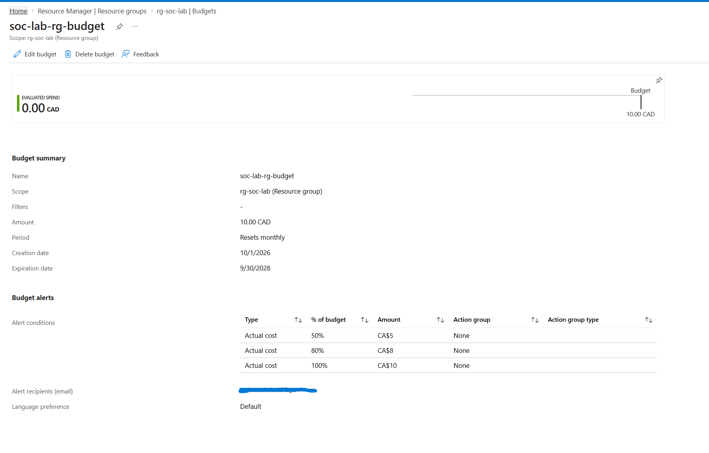
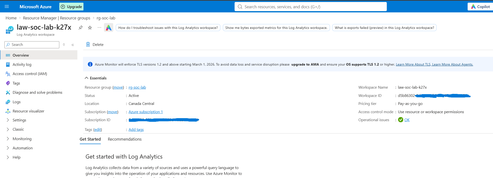
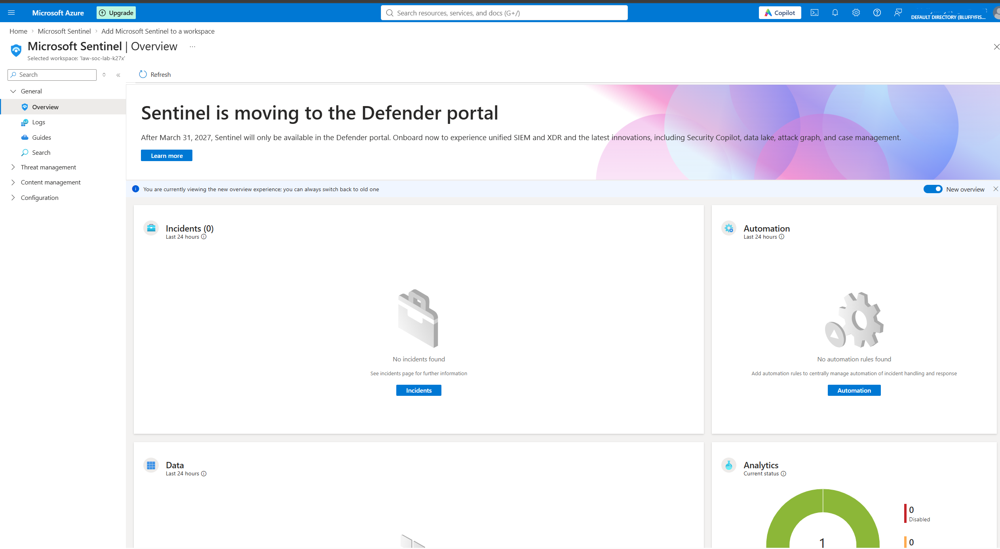
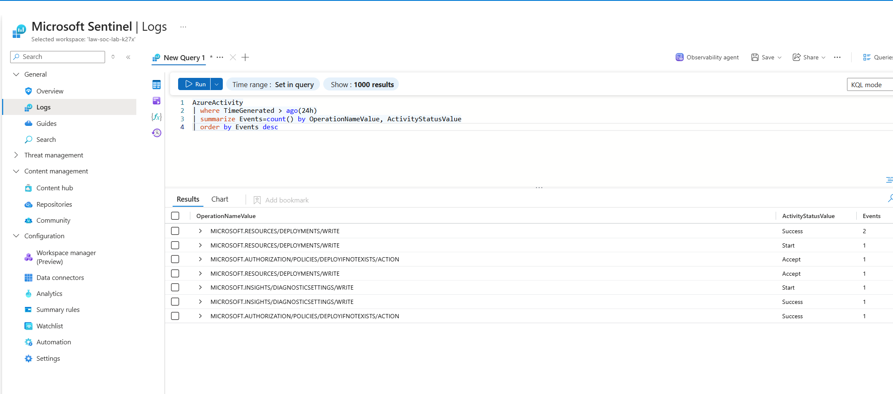
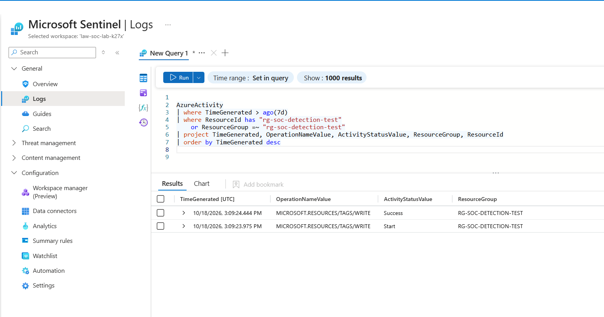
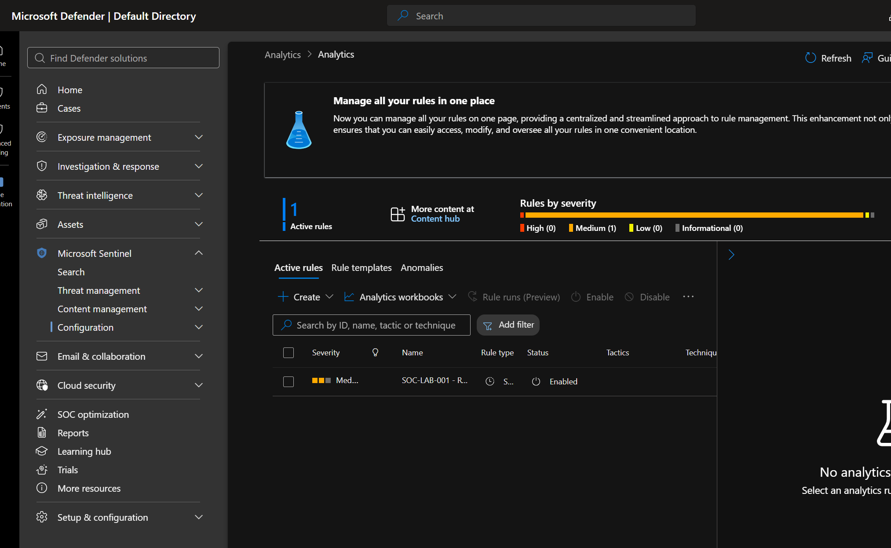
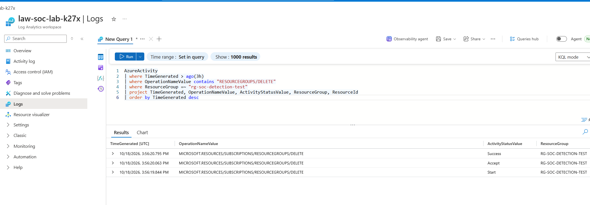
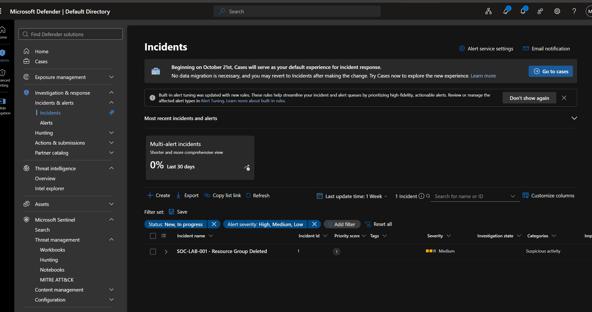
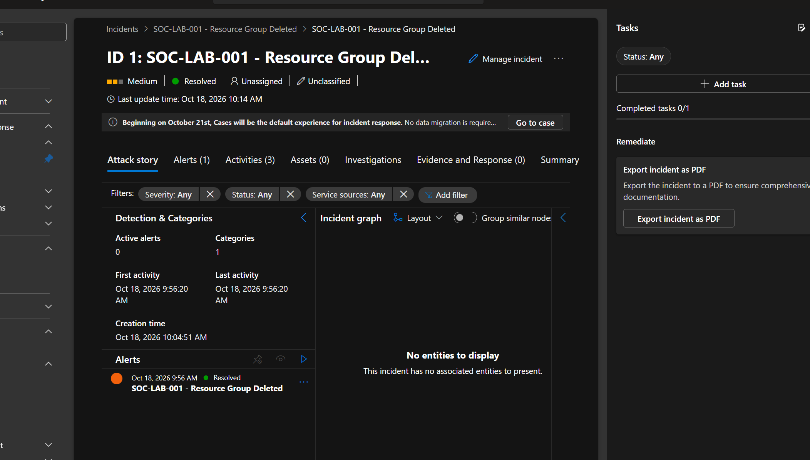
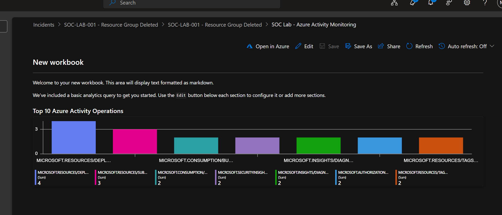

# Azure SOC & Threat Detection Lab

**Microsoft Sentinel · Azure Activity Logs · Log Analytics · KQL**

## Overview

I built this lab to practice how a SOC detects and investigates activity in Microsoft Azure. I collected Azure management logs, wrote a detection rule for resource group deletion, tested it with a disposable resource group, and reviewed the incident in Microsoft Sentinel.

**Goal:** Track an Azure action from the activity log to a Sentinel incident.

## 1. Set a budget

I created a CAD $10 monthly budget for my SOC resource group, `rg-soc-lab`, with spending alerts.

**Why:** Cloud labs can generate charges. I wanted a budget in place before setting up monitoring.

## 2. Create a Log Analytics workspace

I created `law-soc-lab-k27x` in Canada Central.

**Why:** I needed a place to collect and query Azure logs.

## 3. Enable Microsoft Sentinel

I connected Microsoft Sentinel to the Log Analytics workspace.

**Why:** Sentinel lets me turn log searches into detections and incidents.

## 4. Collect Azure Activity logs

I configured Azure Activity ingestion and checked that management operations appeared in the `AzureActivity` table.

**Why:** A detection rule is only useful if the underlying logs are arriving.

## 5. Check baseline activity

I used a disposable resource group, `rg-soc-detection-test`, and checked its activity. I confirmed that activity from the test resource group appeared in the logs.

**Why:** I wanted to confirm the test group's activity was visible before running the detection test.

## 6. Create the detection rule

I created a scheduled Sentinel rule named **SOC-LAB-001 - Resource Group Deleted**. It looks for successful resource group deletion operations in Azure Activity logs.

**Why:** I wanted Sentinel to flag this action automatically instead of searching for it by hand.

**Detection query:** [`kql/resource-group-deleted.kql`](kql/resource-group-deleted.kql)

## 7. Test with a real deletion

I confirmed the test resource group contained no resources, deleted it, and checked Azure Activity for the successful deletion event.

**Why:** Testing against a real event helped me confirm the logs and detection were connected.

## 8. Investigate the incident

I reviewed the Sentinel incident and checked the event details, including the operation, status, time, and affected resource group. The activity was part of my authorized lab test.

**Why:** A SOC analyst needs to understand what happened, not just acknowledge an alert.

## 9. Hunt through logs and build a workbook

I ran KQL searches and saved a workbook named **SOC Lab - Azure Activity Monitoring** with a chart of the top Azure Activity operations.

**Why:** The workbook makes it easier to see patterns without writing the same query every time.

## What I learned

- How Azure Activity logs reach Log Analytics.
- How to use KQL to search for management operations.
- How scheduled Sentinel analytics rules detect specific events.
- How to test a rule and investigate the resulting incident.
- How to use workbooks to summarize activity.
